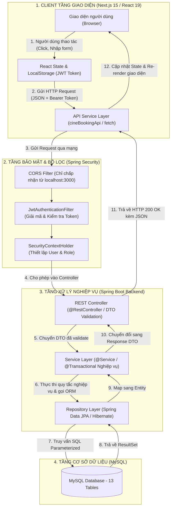
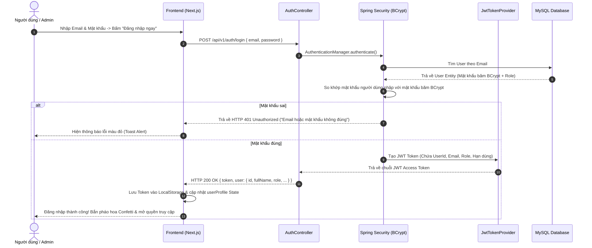
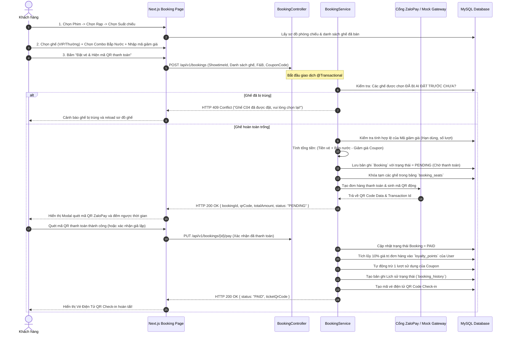

# TÀI LIỆU TOÀN DIỆN: LUỒNG DỮ LIỆU HOẠT ĐỘNG (DATA FLOW) HỆ THỐNG CINEBOOKING

Tài liệu này giải thích chi tiết cách dòng dữ liệu di chuyển từ **Giao diện người dùng (Next.js)** qua **Hệ thống xử lý trung gian (Spring Boot)** xuống **Cơ sở dữ liệu (MySQL)** và phản hồi ngược lại, giúp bạn tự tin trả lời bất kỳ câu hỏi vấn đáp nào từ Giảng viên.

---

## 1. KIẾN TRÚC TỔNG THỂ VÀ LUỒNG ĐI DỮ LIỆU CHUNG (HIGH-LEVEL ARCHITECTURE)

Hệ thống được thiết kế theo mô hình **Decoupled Architecture (Kiến trúc phân tách)** chuẩn công nghiệp:

---

## 2. LUỒNG 1: XÁC THỰC & PHÂN QUYỀN (AUTHENTICATION & JWT FLOW)

Đây là quy trình bảo vệ hệ thống khỏi truy cập trái phép và phân biệt quyền giữa **Khách hàng (Customer)** và **Quản trị viên (Admin)**:

> **Điểm mấu chốt khi bảo vệ đồ án**:
> - Mọi request sau khi đăng nhập đều tự động đính kèm header: `Authorization: Bearer <token>`.
> - Backend không lưu session trong RAM (Stateless), giúp hệ thống mở rộng linh hoạt và tiết kiệm tài nguyên máy chủ.

---

## 3. LUỒNG 2: NGHIỆP VỤ ĐẶT VÉ & THANH TOÁN (BOOKING & PAYMENT FLOW)

Đây là **luồng nghiệp vụ phức tạp và quan trọng nhất** của toàn bộ đề tài:

---

## 4. LUỒNG 3: QUẢN TRỊ ADMIN (CRUD, BÁO CÁO DOANH THU & ĐỒNG BỘ HAI CHIỀU)

Khi Quản trị viên thao tác trên trang Admin Console:

```mermaid
flowchart LR
    subgraph AdminActions ["Thao tác Quản trị"]
        A1["Thêm / Sửa Phim mới"]
        A2["Tạo Suất Chiếu mới"]
        A3["Duyệt / Hủy Đơn Vé"]
        A4["Tạo Mã Giảm Giá"]
    end

    subgraph ValidationSec ["Bảo mật & Kiểm tra"]
        V1["Kiểm tra Quyền: hasRole('ADMIN')"]
        V2["Validate Dữ liệu nhập"]
        V3["Ràng buộc: Không xóa Phim đang chiếu"]
    end

    subgraph Persistence ["Lưu trữ & Thống kê"]
        P1["Lưu MySQL Database"]
        P2["Tính toán lại Doanh thu 7 ngày"]
        P3["Tính tỷ lệ lấp đầy phòng chiếu"]
    end

    subgraph ClientSync ["Đồng bộ tức thì lên Client"]
        S1["Cập nhật bảng dữ liệu 60fps"]
        S2["GSAP re-animate biểu đồ cột"]
        S3["Bắn Toast thông báo thành công"]
    end

    AdminActions --> ValidationSec
    ValidationSec --> Persistence
    Persistence --> ClientSync
```

---

## 5. TỔNG KẾT BẢNG TÓM TẮT DÀNH CHO BÁO CÁO VẤN ĐÁP

| Câu hỏi của Giảng viên | Câu trả lời trọng tâm (Keywords) |
|:---|:---|
| **1. Frontend và Backend giao tiếp qua giao thức nào?** | Qua **RESTful API (JSON)** thông qua giao thức HTTP/HTTPS với các phương thức chuẩn: `GET` (lấy dữ liệu), `POST` (tạo mới/đặt vé), `PUT` (cập nhật trạng thái/thanh toán), `DELETE` (xóa). |
| **2. Làm thế nào để Backend biết ai đang gửi yêu cầu?** | Thông qua **JWT (JSON Web Token)** nằm trong Header `Authorization: Bearer <token>`. Lớp `JwtAuthenticationFilter` tại Backend sẽ giải mã token để lấy User ID và quyền hạn (Role) mà không cần truy vấn lại bảng mật khẩu. |
| **3. Làm sao chống đặt trùng ghế khi hai người bấm cùng lúc?** | Sử dụng **Database Transaction (`@Transactional`)** kết hợp kiểm tra trạng thái ghế `AVAILABLE` tại tầng Service trước khi tạo đơn và khóa ghế tạm thời ở trạng thái `PENDING`. |
| **4. Dữ liệu thay đổi trên Admin có tác động đến Khách hàng không?** | Có, dữ liệu được lưu tập trung duy nhất tại **MySQL Database**. Khi Admin tạo phim mới hoặc đổi giá vé, người dùng tải lại hoặc chuyển tab sẽ lập tức nhận dữ liệu mới nhất từ API. |
